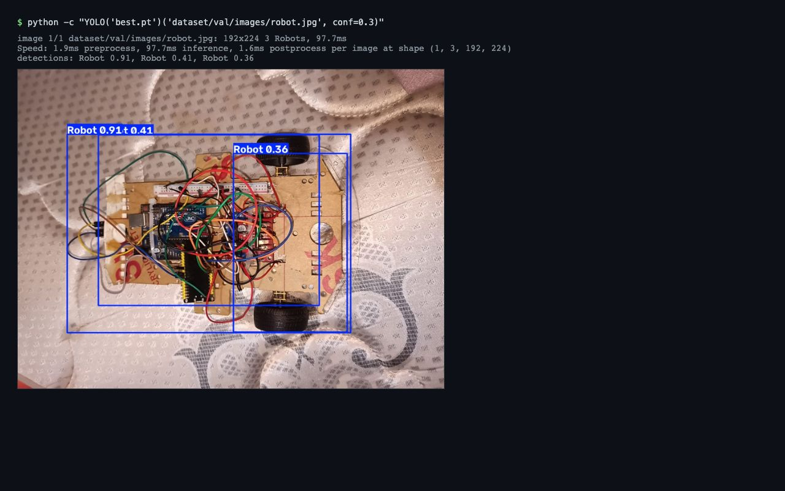

# Robotics Final

University robotics project: a line-follower robot, an ESP32 Wi-Fi remote-controlled car, and YOLOv8 detection of the robot and its target.



*Real output of Ultralytics YOLOv8 running `robotics_object_detection/best.pt` on `dataset/val/images/robot.jpg` (conf 0.3).*

## Layout

| Path | Contents |
|------|----------|
| `Line-Follower-Robot-using-5-Channel-IR/` | Arduino sketch and circuit PDF for a 5-channel IR line follower |
| `robotics_final/` | ESP32 sketch (`esp32/esp32.ino`), Wi-Fi keyboard controller (`controller.py`), line-follow and RNN experiments |
| `robotics_object_detection/` | YOLOv8 training notebooks, dataset (classes `Robot`, `Target`), trained `best.pt`, `object_detection.py` webcam inference |
| `object_detect_robotics/` | Ultrasound sensor sketches/notebooks and earlier object-detection experiments |

## Run the detection demo

```bash
python -m venv .venv && source .venv/bin/activate
pip install ultralytics opencv-python
cd robotics_object_detection
yolo predict model=best.pt source=dataset/val/images/robot.jpg conf=0.3
```

`object_detection.py` does the same on webcam `source=0` and needs a camera.

## Hardware notes

- ESP32 sketches (`robotics_final/esp32*.txt`) contain `YOUR_WIFI_SSID` / `YOUR_WIFI_PASSWORD` placeholders; fill in your own network.
- `controller.py` needs the `keyboard` package. The car's IP is read from the `ROBOT_IP` environment variable (default `192.168.4.1`); set it to the address the ESP32 prints on its serial monitor.
- Hardware code was not run in this audit; only the YOLO demo was.

## Repository size

About 56 MB of model weights, videos and archives (`*.pt`, `*.mp4`, `*.zip`) are committed in history and cannot be removed without rewriting it. `.gitignore` now blocks new ones; use Git LFS or releases for new large files.

## License

MIT, see [LICENSE](LICENSE).
